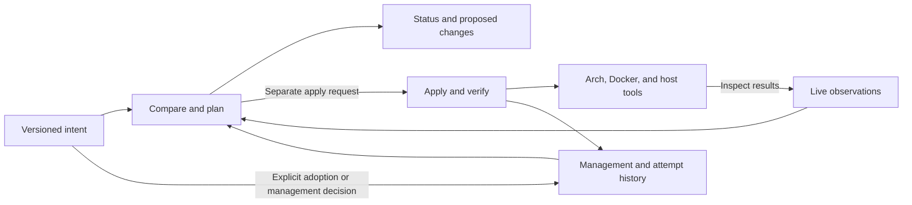

# Server environment: architecture direction

The selected direction is direct use of native Arch, Docker, and host
tools, without Ansible or similar configuration-management frameworks.
The detailed model below remains a design proposal, not an implementation
claim. It supports the
[first milestone](../../plans/2026-10-31-server-environment-milestones.md)
against the [mandate](2026-10-30-server-environment.md). Documentation and
upstream source were inspected on 2026-10-31; runtime behavior has not
been tested.

## Selected direction

Build a local coordinator with an explicit model of software and its
supporting resources. Keep versioned intent, live observations, and
management and application history separate. Delegate package resolution
and installation, container lifecycle, and host operations to existing Arch
and Docker tools through narrowly defined integrations.

The coordinator owns the responsibility, comparison, and recovery
semantics that the product needs. It does not require a new package
resolver, container scheduler, or cross-platform management framework.
Native metapackages can remain useful for selected package collections.
Ansible and similar frameworks are excluded by the user's preference.
The design should not recreate their general workflow machinery: use
concrete integrations for the small set of supported resource kinds.

The [minimum resource model](2026-10-31-server-environment-resources.md)
develops identity, responsibility, management authority, and status.

## Alternatives considered

The assessments below are architectural inferences from the verified
capabilities described afterward, rather than claims that another tool
cannot be extended to meet our requirements.

| Approach | Useful foundation | Work still required | Assessment |
| --- | --- | --- | --- |
| Make Arch packages central | Native dependencies and ownership of supplied static files | Docker and runtime data, shared authority, adoption, live drift, and partial-attempt history | Useful for some resources; making every application fit a package adds artifact maintenance without removing the broader coordination work. |
| Use Ansible for execution | Package and Compose operations, reusable roles, check/diff support, and structured run events | Our responsibility model, controlled inspection, adoption, retirement policy, and current-state interpretation of past events | Excluded by product direction; no framework-backed implementation comparison is required. |
| Extend aconfmgr | Arch-specific capture of an existing installation and inspection of unowned and modified files | Read-only inspection guarantees, gradual adoption, Docker lifecycle, shared authority, and attempt history | Inspection techniques may inform this project; using its reconciliation engine is outside the selected direction. |
| Coordinate native tools directly | Existing Arch package semantics and Docker lifecycle operations | Our common model plus integrations, planning, journaling, and verification | Selected for the bounded Arch-only scope; we own integration correctness. |

### What the existing tools actually provide

Pacman supplies installed-package metadata, dependency handling,
installation reasons, file ownership, and file/configuration checks.
Local configuration may survive an upgrade with a separate `.pacnew`
file, so installed package version alone cannot establish configuration
agreement. Custom packages must not claim files already owned by an
upstream package merely to represent local edits.
[Pacman manual](https://man.archlinux.org/man/pacman.8.en)

Package hooks can coordinate work around a package transaction, but
post-transaction work occurs after package changes. They do not provide
one atomic operation spanning packages, Docker, and application data.
[ALPM hooks](https://man.archlinux.org/man/alpm-hooks.5.en)

Ansible has real execution and inspection capabilities. Its pacman
module supports check/diff, but its documentation specifically warns
about AUR-helper compatibility, including failures with `yay`; AUR
operation needs a demonstrated integration rather than an assumed
drop-in replacement.
[Pacman module](https://docs.ansible.com/projects/ansible/latest/collections/community/general/pacman_module.html)

Check mode is not sufficient as our complete status mechanism: some
modules provide no prediction, some dependent conditions cannot be
evaluated, and tasks can explicitly opt into mutation during a check
run. Controlled observers and visible inspection gaps would still be
needed.
[Check-mode semantics](https://docs.ansible.com/projects/ansible/latest/playbook_guide/playbooks_checkmode.html)
Runner supplies execution events and run outcomes, which informed the
comparison. Neither Runner nor Ansible is part of the selected design.
[Runner artifacts](https://docs.ansible.com/projects/runner/en/stable/intro/#runner-artifacts-directory-hierarchy)

aconfmgr captures installed configuration and includes inspection of
unowned files and modified package files. Its normal save operation
changes declarations, and its usual reconciliation includes pruning
unlisted packages. Its source also has inspection helpers that can
install missing dependencies. Our gradual-adoption and read-only-status
contracts would require explicit adaptation, including reporting the
coverage hidden by ignore rules.
[Upstream documentation](https://github.com/CyberShadow/aconfmgr#readme),
[inspection source](https://github.com/CyberShadow/aconfmgr/blob/master/src/common.bash)

## Structure to refine

### Three separate records

1. **Versioned intent:** Software selections, version requirements,
   configuration, resource relationships, and management authority.
   Retained application data still has a declared purpose after its
   application is retired. Data contents and secret values are not
   automatically copied into this record.
2. **Observations:** What the native package database, Docker, account
   database, and filesystem currently reveal. Observers report scope,
   freshness, and limitations. They do not install missing inspection
   tools or apply configuration as a side effect.
3. **Per-host management and attempt history:** Explicit adoption and
   management decisions preserve the accepted resource inventory,
   relationships, authority, and deployment identity even when no apply
   was needed. Separately record the exact intent and resolved inputs
   targeted by each attempt, actions started and completed, errors, and
   verification results. These records explain later removals and
   interrupted changes without claiming to describe current live state.

Recording an adoption preserves that management baseline independently
of Git commits or application attempts. Later removal or replacement of
an uncommitted declaration must not erase knowledge of what was adopted.
Observation alone does not establish adoption, and adopting an existing
matching setup must not manufacture an application attempt. A focused
design check is: adopt without applying, remove the uncommitted
declaration, and still identify the formerly managed deployment and its
resources for a retirement plan, separately from unrelated discoveries.

The [storage and execution design](2026-10-31-first-release-storage-and-execution.md)
proposes TOML declarations and a protected local SQLite store, with
typed native operations and supervised attempts. These choices remain
subject to its focused mechanism proofs before implementation.
Ordinary status is observation and comparison; no background reconciler
is required. Sensitive values must not leak into status or attempt logs.

### Resources and responsibility

An application or collection references concrete resources: packages,
Docker deployments, configuration, identities, directories, and data.
Several applications may use the same resource. Requiring it does not
grant permission to rewrite or remove it.

The coordinator distinguishes managed, independently wanted, shared,
externally managed, retained, and unresolved resources. These describe
different facts and can overlap. Conflicting requested values for the
same resource must be exposed before application rather than resolved
by whichever application happens to run last.

Package dependencies remain the package manager's responsibility. Our
relationships explain application needs, authority, and lifecycle; they
do not constitute another solver for Arch packages or virtual providers.

### Planning, application, and recovery

Each integration must support observation, a description of proposed
effects and prerequisites, explicit application, and outcome checking.
Unsupported observations remain unknown. A list of opaque shell
commands is insufficient to establish these contracts.

Plans identify the actual input content and relevant observed state,
including recorded changes that have not yet been committed to Git.
Before mutation, recheck prerequisites and surface material changes to
the proposed effects. Serialize this tool's applications on a host;
external tools may still change the server and require re-observation.

Record an action's start before invoking it and its observed outcome
afterward. An interrupted action can have an uncertain or partial
result. Observe again before retrying; do not assume it did nothing or
that reversing Git changes reverses its live effects. Stop dependent
work when a prerequisite fails. The policy for continuing unrelated
work remains a detailed-design decision.

Aggregate native changes into suitable package operations. If a request
requires a wider Arch system upgrade, expose that scope instead of
silently doing a partial upgrade or broadening the operation. Preserve
independently wanted packages and treat AUR acquisition/building as an
explicitly verified integration.
[Arch upgrade constraints](https://wiki.archlinux.org/title/System_maintenance#Partial_upgrades_are_unsupported)

For Docker, adopt the existing deployment identity and inputs so that
moving its declaration does not accidentally create a second deployment.
[Compose project identity](https://docs.docker.com/compose/how-tos/project-name/)
Compose already renders effective configuration and reports running and
stopped containers. Its application operation can recreate containers;
that is an apply action, not an adoption or status operation.
[Compose configuration](https://docs.docker.com/reference/cli/docker/compose/config/),
[Compose status](https://docs.docker.com/reference/cli/docker/compose/ps/),
[Compose application](https://docs.docker.com/reference/cli/docker/compose/up/)

Service retirement must retain enough information to ask about data,
protect shared consumers, and verify stopping. Data deletion needs the
operator's decision and the identified scope; it cannot be inferred
from disappearance of an application declaration. Compose distinguishes
ordinary teardown from volume removal, but that distinction alone does
not establish our shared-resource authority or retained-data policy.
[Compose removal](https://docs.docker.com/reference/cli/docker/compose/down/)

### File accountability

Combine package ownership and available package baselines, explicitly
declared customizations, expected runtime-data rules, and live inventory.
For package-owned configuration, retain the distinction between the
upstream-supplied baseline and the operator's intended customization.
Lack of a usable baseline is an inspection limitation, not evidence of
unchanged content.

Runtime rules describe the responsible application, purpose, expected
locations and kinds of variation. They explain expected responsibility,
not who actually wrote every byte. Broad exclusions cannot make unknown
files disappear from the coverage report. Native package ownership is
one source of evidence; application data need not be falsely registered
as package payload to be accounted for.

### Reusable application knowledge

Future application support should produce inspectable resource
requirements and checks that participate in this same model. Local
customizations remain explicit. Arbitrary install/uninstall scripts
alone would hide the relationships needed for status and retirement.
The contribution mechanism is deferred to its milestone; this does not
select a plugin API, language, or distribution system now.

## Cost and questions before implementation

The selected direction requires real work: reliable observation, bounded
filesystem scans, file baselines, shared authority, interrupted-action
recovery, and native integration tests. Existing tools reduce execution
work but do not automatically supply this product's complete semantics.
The preference for direct integrations is a product decision, not a
measured claim about cost relative to a framework.

Refine the minimum resource contract and validate the hardest
milestone-1 operations with native tooling: nondisruptive adoption,
actual repository/AUR installation, and a failed Docker change with
truthful subsequent status. Identify concrete resource scope, success
checks, version support, and retention of attempt history. Language,
file formats, state storage, privilege boundaries, and the exact role of
metapackages remain
open. Validation must include adoption without an apply followed by
declaration removal, to verify that management history survives this
path. Any implementation experiment must use the milestone's disposable
Arch environment; none has been performed as part of this comparison.
